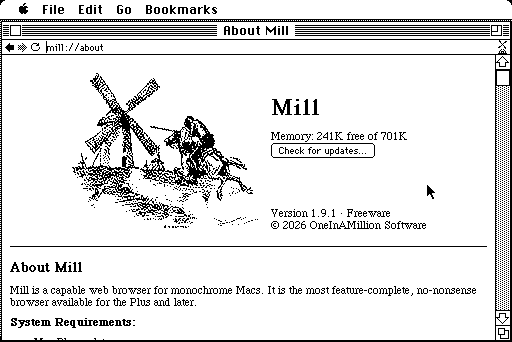
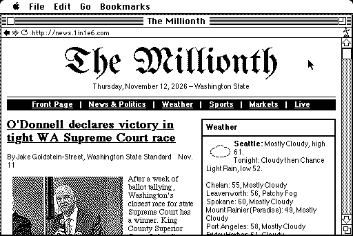
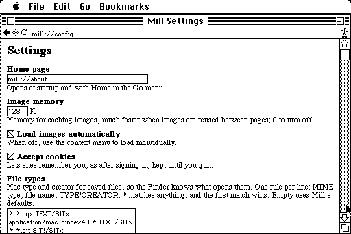

# Mill

A web browser for classic Macs.

Mill is a capable web browser for classic monochrome Macs. It is the most feature-complete,
no-nonsense browser available for the Plus and later. It is designed to fill a software gap
that left the 68000-based machines without a browser capable of rich layouts, including tables
and inline images, which is achievable for them.

Freeware from OneInAMillion Software.

On a Mac Plus running System 6.0.5.

## Download

From the [releases](https://github.com/eric-cgn/mill/releases) or at http://mill.1in1e6.com/

Two downloads, each as BinHex (`.hqx`) and MacBinary (`.bin`):

- **Install Mill** (`Install-Mill-2.1`): Easy Install includes Mill and its Plug-Ins; Custom
  Install also offers the Plug-In SDK.
- **Install Millennium Pack** (`Install-Millennium-Pack-1.0`): the out-of-period Plug-Ins (see
  `extras/README.md`, on the `extras` branch), for an existing Mill
  installation.

Four 800K disks, as Disk Copy 4.2 images (`.image`):

| Part No. | Disk | What's on it |
|---|---|---|
| #1E6-DM01-N, #1E6-DM01-P | Mill System Disk, Network and Personal Editions | System 6.0.5 for a Plus with 1 MB RAM, from your own Apple disks. Not distributable, never offered: see [docs/system-disk.md](docs/system-disk.md) |
| #1E6-DM02-V21 | Mill Program Disk (`Mill-2.1.image`) | Mill ready to run: Mill and its Mill Plug-Ins folder with the Plug-Ins and Web Fonts, as Easy Install installs them |
| #1E6-DM03-V21 | Mill Extras Disk (`MillExtras-1.0.image`) | the Millennium Pack's Plug-Ins, to drag into Mill Plug-Ins |
| #1E6-DM04-V21 | Mill Distribution Disk (`MillDistribution-2.1.image`) | Install Mill and Install Millennium Pack |

The Program Disk's part number follows Mill's version (V21 for 2.1). With the System Disk in
one drive and the Program Disk in the other, a Plus with 1 MB RAM runs Mill. If only one drive is available, boot the Macintosh, then eject the System Disk and run Mill from the program disk. The
Plug-In SDK is on its own disk and in a `.zip` (`./build.sh kit`), and in Install Mill's
Custom Install.

## Building

How to make each disk and download. Run everything from the top of the repository, on macOS
or Linux. The names below are for Mill 2.1 (`MILL_VERSION` in `src/version.h`) and Millennium
Pack 1.0 (`version` in `extras/installer/extras.ini`).

| To make | Run | It makes |
|---|---|---|
| Mill only | `./build.sh` | `build/Mill.bin` (MacBinary) and `build/Mill.dsk` |
| Mill Program Disk | `./build.sh` then `./build.sh disk` | `dist/Mill-2.1.image`; also the Plug-Ins in `plugins/*/build/` and Web Fonts in `build/fonts/` |
| Install Mill | `./build.sh`, `./build.sh disk`, then `./build.sh installer`; then `python3 tools/release.py` | `build/installer/Install-Mill-2.1.bin` and `.hqx`, made with EUP from `installer/mill.ini`; `tools/release.py` copies them to `dist/` and checks that `dist/Mill-2.1.image` is there |
| Plug-In SDK | `./build.sh kit` | `dist/PlugInSDK-2.1.dsk` (an 800K disk named "Mill Plug-In SDK") and `dist/PlugInSDK-2.1.zip` |
| Mill System Disk, Network Edition | `python3 tools/systemdisk/make_system_disk.py OUTDIR` | `OUTDIR/Mill-System-Disk-Network.image` (Disk Copy 4.2) and `.dsk` (raw) |
| Mill System Disk, Personal Edition | `python3 tools/systemdisk/make_system_disk.py --personal OUTDIR` | `OUTDIR/Mill-System-Disk-Personal.image` and `.dsk` |
| Install Millennium Pack, Mill Extras Disk, and Mill Distribution Disk | `./build.sh`, `./build.sh disk`, and `./build.sh installer`, then `extras/build.sh`; then `python3 extras/tools/release.py` | `extras/build/installer/Install-Millennium-Pack-1.0.bin` and `.hqx`, `extras/dist/MillExtras-1.0.image`, and `extras/dist/MillDistribution-2.1.image`; `extras/tools/release.py` copies the installer to `extras/dist/` and checks all four |

Requirements:

- **Docker**, for all of Mill's builds. They run in [Retro68](https://github.com/autc04/Retro68)'s
  image (`ghcr.io/autc04/retro68`, pinned by digest in `build.sh`), as `linux/amd64`; Web
  Fonts also runs in `python:3.12-slim`, pinned by digest. They need nothing else installed. The
  code is plain 68000.
- **Python 3**, only for the System Disk tool (and the release scripts, `tools/release.py` and
  `tools/site.py`). The tool makes
  its own virtual environment; on Debian and Ubuntu it requires the `python3-venv` package.
- **Network access**, for:
  - Docker's images, the first time.
  - `./build.sh disk`: Web Fonts' Python packages, pinned, from PyPI (freetype-py 2.5.1,
    macresources 1.2, and fontTools 4.68.0). The font files themselves are in
    `tools/extras/fonts/`.
  - `./build.sh installer`: [EUP](https://github.com/eric-cgn/eup) 1.3's source release, fetched
    once into `build/eup-1.3.tar.gz` and checked by SHA-256. Until that release is on GitHub,
    put the archive there yourself.
  - The System Disk tool: Apple's System 6.0.5 disks and one disk of System 7.5 Update 2.0,
    from the Internet Archive's copies of Apple's download site, and machfs and macresources
    from PyPI, all pinned by SHA-256, into `tools/systemdisk/cache`.
  - `extras/build.sh` needs no network, so `build/eup-1.3.tar.gz` must already be there
    (`./build.sh installer` fetches it).

The System Disk may be created from the included LGPL'd script. The Network Edition is for LocalTalk or Ethernet,
and the Personal Edition for dial-up; [docs/system-disk.md](docs/system-disk.md) describes
each and how to make one by hand.

The Millennium Pack and its two disks are on the `extras` branch, in `extras/`, until it is
merged; `extras/README.md` there has the details.

`tests/run.sh` runs the host tests for the portable core.

## System requirements

- Mac Plus or later, 1 MB RAM
- System 6.0.3, MacTCP 1.1, or later
- 700K free RAM
- Recommended: System 6.0.8, 2 MB RAM
- About 800K of disk for everything

## Capabilities

- HTML 3.2: text, lists, tables, images (incl. maps), and forms
- Non-standard common extensions: bgcolor, font face
- Character sets: UTF-8, ISO 8859-1, and Mac Roman
- Image formats: GIF (static) and JPEG (baseline), dithered for one-bit screens
- Cookies (session only)
- Basic and Digest logins
- Downloads, optional MacBinary decoding
- HTTP proxy support
- URL schemes: http:// (https:// w/ proxy), file://, and mill:// (built-ins)
- Plug-Ins: Internet Services (ftp, gopher, finger, whois, dict, time), SMB (smb), NFS (nfs), News (news, nntp), LDAP (ldap), IMAP (imap), Image Formats (MacPaint, PICT, XBM, BMP, Netpbm, and PNG), Archives (zip, tar, gzip, MacBinary, and BinHex), and Web Fonts

## Plug-Ins

`sdk/` is the Plug-In SDK (`./build.sh kit`). Every Plug-In file carries an `'MIfc'` resource,
ID 128: two bytes, the interface it was built for (`kMillInterface`, set only in
`sdk/Interfaces/MillInterface.h`; `sdk/Interfaces/MillPlugIn.r` makes the resource). Mill reads
it before loading any of the Plug-In's code and skips a file without it or with another number;
mill://plugins says why, and an alert at startup names them.

## Build details

`./build.sh disk` also makes Web Fonts, with `tools/extras/build.py` in a pinned Python image
with pinned packages, from the font files kept in `tools/extras/fonts/` (see its Read Me). The
fonts need no download, and the same sources give the same bytes.

The splash's two pictures, `src/splash.r` and `src/splash_text.r`, are committed; no build
makes them. To redo them, on a Mac (it needs `sips` and `cc`): `python3 tools/splash.py` for
the drawing, after changing `art/quixote.jpg`, and `python3 tools/splash.py text` for the
words, after `./build.sh disk` and a change to the fonts, the year, or the publisher. Commit
the results.

Where each step's inputs come from:

| Step | Makes | Inputs |
|---|---|---|
| `tests/run.sh` | host test results | `tests/`, `src/core/`; the Retro68 image (ghcr.io, pinned by digest) |
| `./build.sh` | `build/Mill.bin`, `build/Mill.dsk` | `src/`, with the committed splash pictures; the Retro68 image |
| `./build.sh disk`: Plug-Ins | `plugins/*/build/` | `plugins/`, `sdk/`; the Retro68 image |
| `./build.sh disk`: Web Fonts | `build/fonts/` | `tools/extras/fonts.json` and `fonts/` (Adobe's and Bitstream's X11 fonts from x.org, Tinos from google/fonts; addresses and SHA-256s in fonts.json), `plugins/fonts/build/Web Fonts.flt`; python:3.12-slim (Docker Hub, pinned by digest), freetype-py 2.5.1, macresources 1.2, and fontTools 4.68.0 from PyPI |
| `./build.sh disk`: Mill Program Disk | `dist/Mill-VERSION.image` | the builds above, `tools/disk.py`; the Retro68 image |
| `./build.sh installer` | `build/installer/Install-Mill-VERSION.bin`, `.hqx` | the builds above, `installer/`, `sdk/`; EUP's source release from GitHub (or `build/`), pinned by SHA-256 in `tools/installer.py` |
| `tools/release.py` | `dist/Install-Mill-VERSION.bin`, `.hqx` | `build/installer/` |
| `./build.sh kit` | `dist/PlugInSDK-VERSION.dsk`, `.zip` | `sdk/`; the Retro68 image |
| `tools/systemdisk/make_system_disk.py` | `OUTDIR/Mill-System-Disk-Network.image`, `.dsk` (`-Personal` with `--personal`) | Apple's System 6.0.5 disks and System 7.5 Update 2.0 disk 3 (Internet Archive), machfs and macresources (PyPI); all pinned by SHA-256 |
| `extras/build.sh` (`extras` branch) | `extras/build/installer/Install-Millennium-Pack-VERSION.bin`, `.hqx`; `extras/dist/MillExtras-VERSION.image`, `MillDistribution-MILLVERSION.image` | `extras/`, `build/Mill.bin`, `build/installer/`, `build/eup-1.3.tar.gz`; the Retro68 image, with no network |
| `tools/splash.py` (by hand) | `src/splash.r` | `art/quixote.jpg` (Wikimedia Commons, see `art/README`); macOS `sips` |
| `tools/splash.py text` (by hand) | `src/splash_text.r` | `build/fonts/Web Fonts.bin`, `plugins/fonts/` (built with the Mac's `cc`), `src/version.h` |

## License

MIT. Mill also includes ChaN's TJpgDec (`src/third_party/tjpgd`), and the built app includes parts of
newlib, Multiversal Interfaces, and the Retro68 and GCC runtimes; their notices are in
`src/license.html`, shown as mill://license. Install Mill is made with EUP (MIT), and includes
parts of the same three; its notice is there too.

One folder is licensed differently: `tools/systemdisk/`, the script that builds the Mill System
Disk, is under the GNU LGPL 2.1 or later (its `LICENSE` is in that folder). It is a separate
tool that runs on your own computer. Mill doesn't use its code, and it isn't part of any Mill
binary or disk image.

The splash screen is George A. Harker's drawing of Don Quixote and the windmills, from James
Baldwin's *Stories of Don Quixote* (1910), in the public domain (see `art/README`).
