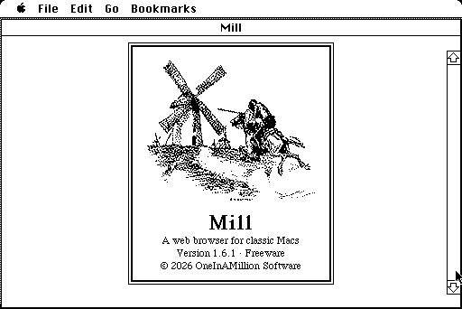
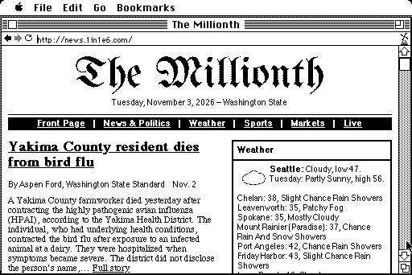
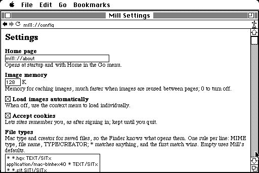

# Mill

A web browser for classic Macs.

Mill is a capable web browser for monochrome Macs. It is the most feature-complete,
no-nonsense browser available for the Plus and later.

Freeware from OneInAMillion Software.

On a Mac Plus (512×342) running System 6.0.8.

## System requirements

- Mac Plus or later
- System 6.0.8 with MacTCP or later
- 1 MB RAM available

## What it reads

- HTML 3.2: text, lists, tables, images (and maps), and forms, plus a few extras like
  bgcolor and font face
- URL schemes: http://, file://, and mill:// (built-ins)
- Character sets: UTF-8, ISO 8859-1, and Mac Roman
- Image formats: GIF (static) and JPEG (baseline), dithered for one-bit screens
- Cookies, kept until you quit
- Basic and Digest logins
- Downloads, with MacBinary decoding

## Download

From the [releases](https://github.com/eric-cgn/mill/releases), or at
http://mill.1in1e6.com/

## Building

`./build.sh` builds `build/Mill.bin` (MacBinary) and `build/Mill.dsk` with
[Retro68](https://github.com/autc04/Retro68) in a container (image pinned by digest).
The code is plain 68000. `tests/run.sh` runs the host tests for the portable core.

After editing `src/changes.html` or `src/license.html`, run `python3 tools/pages.py`.

## Releases

Pushing a tag `vX.Y.Z` that matches `MILL_VERSION` in `src/version.h` builds Mill, makes a
GitHub release with `Mill-X.Y.Z.hqx`, `.bin`, and `.dsk` (`tools/release.py`), and rebuilds
the download site from every release (`tools/site.py`).

## License

MIT. Mill also includes ChaN's TJpgDec (`src/third_party/tjpgd`), and the built app parts of
newlib, Multiversal Interfaces, and the Retro68 and GCC runtimes; their notices are in
`src/license.html`, shown as mill://license.

The splash screen is George A. Harker's drawing of Don Quixote and the windmills, from James
Baldwin's *Stories of Don Quixote* (1910), in the public domain (see `art/README`).
